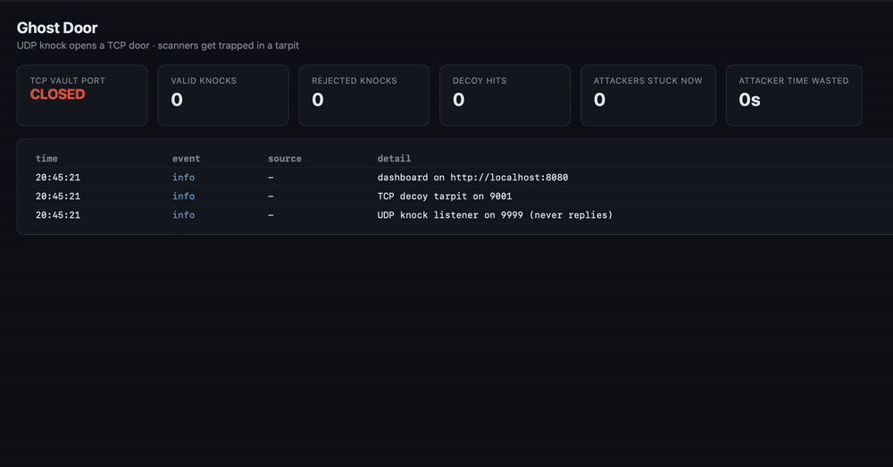

# Ghost Door — a UDP-knock stealth server with a TCP tarpit

**Computer Networks – Assignment 4.** A small defensive security tool that
uses **UDP and TCP for what each is best at**, plus the attacker tools used to
test it. Python standard library only, no installs.



*Dashboard during a run (2x speed): the scanner gets trapped in the tarpit, a
valid UDP knock opens the TCP door, forged and replayed knocks are rejected,
and the door closes again.*

## The idea

| Port | Proto | Behaviour |
|------|-------|-----------|
| 9999 | UDP | Silent knock listener. Never replies, so a scanner can't tell it exists. |
| 9000 | TCP | The real service (a secret vault). **Closed** (kernel RST) until a valid knock arrives. |
| 9001 | TCP | Decoy "service", always open: an *endlessh-style tarpit* that drips junk bytes and wastes the attacker's time. |
| 8080 | HTTP | Live dashboard of every event. |

**Why UDP for the knock?** It is connectionless: no handshake, no reply, no
state, so there is nothing for a scanner to detect or SYN-flood.
**Why TCP for the vault?** It needs a reliable, ordered, stateful stream, and
the 3-way handshake is what lets the server decide, per source IP, who gets in.

### Knock packet (51 bytes)
`MAGIC(3) | timestamp_ms(8) | nonce(8) | HMAC-SHA256(32)`

- HMAC with a shared secret → **forged** knocks are rejected (`knock_badsig`).
- Timestamp window (10 s) → **old** packets are rejected (`knock_stale`).
- Server remembers nonces → a captured packet **replayed inside the window**
  is rejected (`knock_replay`).
- A valid knock opens the door only for the **source IP of the knock**, for
  `--window` seconds (default 30), then the listener closes again.

## Quick start

Requires Python 3.10+.

**1. Extra loopback IPs (macOS only, once per reboot).** The demo uses
`127.0.0.2` as the defender and `127.0.0.3` as the attacker so one computer can
play both roles. Linux has these by default; macOS needs:

```bash
sudo ifconfig lo0 alias 127.0.0.2 up
sudo ifconfig lo0 alias 127.0.0.3 up
```

**2. Run the whole narrated demo with one command:**

```bash
python3 run_all.py
```

It starts `server.py`, opens the dashboard at `http://localhost:8080`, and runs
the scan, tarpit, knock, vault session, replay and forgery steps in order.
Options: `--fast` (no pauses), `--window 60` (door open longer),
`--keep` (leave the server running), `--no-browser`.

**3. Or run the pieces by hand (3 terminals):**

```bash
# terminal 1 – server (+ dashboard at http://localhost:8080)
python3 server.py

# terminal 2 – attacker (127.0.0.3 acts as a different machine)
python3 scanner.py --ports 8990-9010 --src 127.0.0.3    # 9000 closed, 9001 open
python3 scanner.py --ports 9001 --src 127.0.0.3 --grab  # gets stuck in the tarpit
python3 vault_client.py --src 127.0.0.3                 # refused: door closed

# terminal 3 – defender
python3 knock.py --src 127.0.0.2 --print-hex
python3 vault_client.py --src 127.0.0.2                 # LIST / GET flag / QUIT

# terminal 2 – attacker tries to beat the knock
python3 replay_attack.py replay --hex <hex from above> --src 127.0.0.3
python3 replay_attack.py forge --src 127.0.0.3
```

**4. Automated test** (starts its own server, so stop any running `server.py`
first): `python3 run_demo.py` prints PASS/FAIL for 10 checks (scan, tarpit,
knock, replay, forgery, silence, expiry).

> **Ethics:** only run scanners and attacks against your own machine or lab.
> For two real machines, drop `--src` and set `--host` to the server's IP.

## Limitations (honest ones)

- While the door is open for one IP, the TCP port completes handshakes for
  everyone; other IPs are reset right after (logged as `intruders_refused`).
  A production version would filter per IP in the firewall (iptables / nftables).
- The shared secret is static; real systems would use per-user keys or
  asymmetric signatures.
- An on-path observer who sees a valid knock could race the legitimate client
  from a spoofed address within the window. This is a teaching tool, not a
  hardened product.
- Sessions are cut when the window ends (knock again to continue).

## Agentic AI log

*(Rewrite this section in your own words before submitting.)*

- Used an AI coding agent to scaffold the protocol, server, attacker tools,
  dashboard and tests, then read and ran every part myself.
- First test run: 2 of 10 checks failed. My test assumed the port is refused
  for the attacker, but during an open window the handshake succeeds and the
  server resets it afterwards. Fixed the test and documented the behaviour.
- On macOS the demo failed with `Errno 49 Can't assign requested address`
  because only `127.0.0.1` exists on loopback; fixed by adding aliases.
- In my recorded run the replay showed as `knock_stale`, not `knock_replay`:
  it arrived after the 10 s window. Both checks protect against replay.
- Next: ask the agent to red-team the design (spoofing, tarpit resource
  exhaustion, capped by `--tarpit-conns`) and record what it finds.

## Files

| File | Purpose |
|------|---------|
| `server.py` | Knock listener, hidden TCP vault, decoy tarpit, dashboard server |
| `common.py` | Knock packet format, signing and verification |
| `knock.py` | Defender's knock client |
| `vault_client.py` | Client for the hidden vault |
| `scanner.py` | Attacker's port scanner and banner grabber |
| `replay_attack.py` | Replay / forged / stale knock attacks |
| `run_all.py` | One-command narrated demo |
| `run_demo.py` | Automated pass/fail test |
| `dashboard.html` | Live dashboard page |
| `ghostdoor_demo.gif` | Demo recording shown above |
